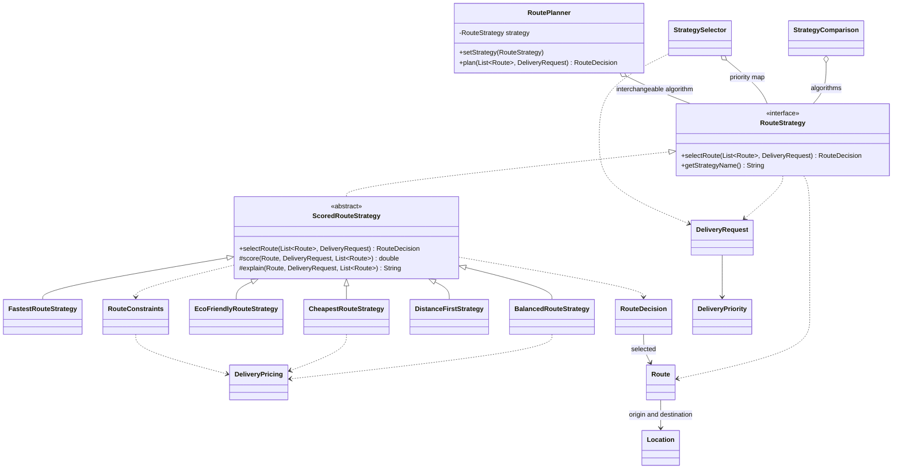

# Smart Delivery & Route Optimization Engine

Assignment 5 — Strategy Pattern. Java 17+, Maven, JUnit 5.

## Run in IntelliJ IDEA

Open this folder (or `pom.xml`) as a Maven project, select a JDK 17 or newer,
let Maven import dependencies, and run `kz.arsen.delivery.Main` using the green
arrow beside `main`. To run tests, right-click `src/test/java` and select **Run All Tests**.
The demo is deterministic and needs no input, network service, or API keys.

From a terminal with a JDK installed:

```sh
./mvnw clean verify
java -jar target/smart-delivery-engine-1.0.0.jar
```

Windows: use `mvnw.cmd clean verify`. The wrapper downloads Maven 3.9.9 on its first run.

## Architecture and Strategy

**Problem solved:** route-selection algorithms change independently of delivery
planning. Strategy encapsulates each scoring policy behind `RouteStrategy`.
`RoutePlanner` is the Context: it stores only a `RouteStrategy` reference and
delegates `plan` to `selectRoute`; it has no algorithm names, type checks or switch.

**Concrete strategies:** `FastestRouteStrategy`, `CheapestRouteStrategy`,
`EcoFriendlyRouteStrategy`, `BalancedRouteStrategy`, `DistanceFirstStrategy`.
They share the constraint/audit pipeline in `ScoredRouteStrategy` but provide
different scoring functions and explanations. This small template method avoids
duplicating mandatory validation; the planner still uses composition and Strategy.

**Runtime switching:** `Main` reuses one planner, first with Fastest, then calls
`setStrategy` three times: Cheapest → Eco-friendly → Balanced. The comparison mode
runs all five algorithms with the same immutable request and eight route candidates.
`RouteDecision` returns the route, score, explanation, all feasible scores and
rejection reasons. This intentionally improves the example interface's return type
from `Route` to `RouteDecision`, so explanations are structured rather than side effects.

**Selection policy:** `StrategySelector` receives a priority-to-strategy map.
URGENT → Fastest, ECONOMY → Cheapest, ECO → Eco-friendly, STANDARD → Balanced.
A soft `ecoPreferred` flag selects Eco unless the request is urgent. This policy
chooses **which** algorithm to use; each strategy decides **how** to rank routes.
The map is injected and validated, with no giant algorithm-selection switch.

**Why not simple if/else?** algorithm implementations are independently replaceable
objects. Adding an algorithm does not add branches to `RoutePlanner` or require
changing the shared safety pipeline.

## Domain, formulas and constraints

`Location`, `Route` and `DeliveryRequest` are validated records. Routes include
availability, traffic, weather and extra fees. Costs are KZT, distance is km,
time is minutes, and carbon emission is estimated kg CO2. The eight candidates
are alternate paths between one warehouse and one customer.

- Fastest: `effectiveTime = estimatedMinutes + trafficPenaltyMinutes + weatherPenaltyMinutes`.
- Cheapest: `totalCost = baseCost + distanceKm * 80 + additionalFees + urgentSurcharge`.
  The surcharge is 500 KZT for URGENT and zero otherwise. `DeliveryPricing` supplies
  the identical quote for budget checks, scoring and display. The surcharge affects
  feasibility; being flat, it does not change ranking among routes for one request.
- Eco: `ecoScore = carbonEmission * emissionWeight + distanceKm * distanceWeight`.
  Defaults are 0.9 and 0.1; coefficients are nonnegative, finite, and not both zero.
  These coefficients convert kg and km into policy score units; this is a deliberately
  simple heuristic, not a physical emissions model. The formula belongs in the eco
  strategy because it defines that policy's ranking, not a universal delivery constraint.
- Balanced: `score = norm(time)*wt + norm(totalCost)*wc + norm(distance)*wd + norm(emission)*we`.
  `norm(x) = (x-min)/(max-min)` over feasible routes only; a constant column contributes 0.
  Default weights are 0.40 / 0.30 / 0.10 / 0.20. All are finite and nonnegative and
  must sum to 1 within 1e-9. Invalid configurations fail immediately.
- Distance-first: minimize distance among feasible candidates.

Every algorithm first rejects unavailable routes, quotes above budget, effective
time beyond the deadline, emissions above the limit and prohibited route IDs.
The budget, deadline and emission boundaries are inclusive. All violations are
reported per route; invalid routes never influence Balanced normalization.
Lower score wins. Equal scores are resolved by lexicographically smallest route ID,
independently of input order. Scores have different units across strategies and
must not be compared numerically between strategies.

An empty list or no feasible route throws `NoSuitableRouteException`, including
rejection details. Negative/nonfinite values, invalid coordinates, duplicate IDs,
null input and time overflow fail explicitly. Request sets and decision collections
are defensively copied. The demo catches three expected failure scenarios.

## Example output and validation

For STANDARD / 6000 KZT / 60 min / 10 kg maximum CO2:

| Strategy | Route | Effective time | Total cost | Distance | CO2 | Score |
|---|---|---:|---:|---:|---:|---:|
| Fastest | B | 22 min | 4500 KZT | 15 km | 3.5 kg | 22 |
| Cheapest | D | 40 min | 2240 KZT | 18 km | 3.0 kg | 2240 |
| Eco-friendly | C | 42 min | 2600 KZT | 10 km | 0.5 kg | 1.45 |
| Balanced | F | 30 min | 2920 KZT | 14 km | 1.4 kg | 0.3617 |
| Distance-first | E | 35 min | 2740 KZT | 8 km | 2.0 kg | 8 |

Route G is unavailable. Route H exceeds the standard budget. An urgent request
with budget 10000 and deadline 25 selects H; an economy request with budget 2500
selects D; an eco-preferred standard request with budget 4000 selects C.
See [full console output](docs/console-output.txt), including formulas, candidate
scores, rejection reasons, runtime switches and expected failures.

**Verified 2026-10-28:** 30 JUnit 5 tests, 0 failures, 0 errors, 0 skipped.
See [test results](docs/test-results.txt). Tests cover hand-calculated scores,
configurable weights, traffic/weather, all constraints, three runtime switches,
selector policy, request-dependent choices, fifth strategy, comparison, exact
boundaries, deterministic ties, equal metrics, immutability and invalid data.
GitHub Actions repeats `./mvnw -B clean verify` using Java 17 on pushes and pull requests.

## Extensibility, SOLID and limitations

To add a strategy, extend `ScoredRouteStrategy`, implement `score`, `explain` and
`getStrategyName`, then register the object in the client's comparison list or
selector map. For a completely different implementation, implement `RouteStrategy`
directly and preserve its safety and audit contract. The fifth strategy was added
in a separate commit after the original four-strategy application built and ran.
Only `Main` changed to register it; the Context, selector and other strategies did not.

- **SRP:** planner delegates, selector chooses policy, pricing quotes, constraints
  validate eligibility, and strategies rank candidates.
- **OCP:** fifth strategy extends behavior through the interface without editing the Context.
- **DIP:** the Context and comparison service depend on `RouteStrategy`, not implementations.

**Strategy vs Bridge:** Strategy exchanges an algorithm for one responsibility at
runtime. Bridge separates two independently varying dimensions (an abstraction
and its implementation), such as a notification type and delivery channel.
The previous assignment's source is not included here, so this comparison describes
pattern intent without claiming details about that implementation.

**Limitations:** the system selects among provided routes; it does not calculate
paths on a graph or solve multi-stop vehicle routing. Traffic/weather and emissions
are static estimates. Monetary values use double for an educational example rather
than decimal accounting. Balanced min-max scores depend on the candidate set and
currently rescan it for every score (O(n²)); the other policies are O(n) except
output sorting. The mutable planner is intended for one-thread demo use. Request
endpoints are implicit in the supplied candidate list. There is no persistence or live traffic API.

## UML class diagram



## UML sequence diagram

```mermaid
sequenceDiagram
    participant Client as Main
    participant Selector as StrategySelector
    participant Planner as RoutePlanner
    participant Fastest as FastestRouteStrategy
    participant Constraints as RouteConstraints
    participant Pricing as DeliveryPricing
    Client->>Selector: select(urgentRequest)
    Selector-->>Client: FastestRouteStrategy
    Client->>Planner: setStrategy(fastest)
    Client->>Planner: plan(routes, urgentRequest)
    Planner->>Fastest: selectRoute(routes, urgentRequest)
    Note over Fastest: inherited safety pipeline in ScoredRouteStrategy
    loop each candidate route
        Fastest->>Constraints: violations(route, request)
        Constraints->>Pricing: totalCost(route, request)
        Pricing-->>Constraints: quote
        Constraints-->>Fastest: list of violation reasons
    end
    alt at least one feasible route
        Note over Fastest: score feasible candidates by effective time; tie-break by ID
        Fastest-->>Planner: RouteDecision(route, score, reason, scores, rejections)
        Planner-->>Client: RouteDecision
    else no feasible route
        Fastest-->>Client: NoSuitableRouteException via RoutePlanner
    end
```
